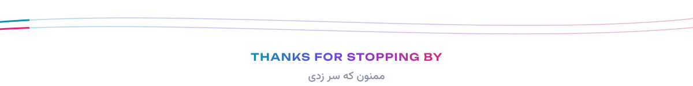

 

 

 

**سلام، من سهندم 👋** با پایتون روی داده‌ی بازارهای شلوغ کار می‌کنم: از جمع‌آوری و تمیز کردن آگهی‌ها تا مدل‌سازی و تصمیم. **CARO** برای آگهی‌های خودروی کارکرده بازه‌ی قیمت بازار را تخمین می‌زند و بعد سعی می‌کند خودش را رد کند. **SorinFlow** آگهی‌های ملک دیوار را جمع‌آوری می‌کند، داده‌ها را مدیریت می‌کند و همه را به یک CRM فارسی می‌رساند.

 

  <a href="https://caro-rho.vercel.app"><b>▶ Live demo</b></a>&nbsp;&nbsp;·&nbsp;&nbsp;<a href="https://github.com/sahandmusanezhad/caro">Source</a>&nbsp;&nbsp;·&nbsp;&nbsp;<a href="https://github.com/sahandmusanezhad/caro/blob/main/docs/ARCHITECTURE.md">Architecture</a>&nbsp;&nbsp;·&nbsp;&nbsp;<a href="https://github.com/sahandmusanezhad/caro/blob/main/docs/DECISIONS.md">Decision log</a>

  <a href="https://sorinflow.com"><b>▶ sorinflow.com</b></a>&nbsp;&nbsp;·&nbsp;&nbsp;built with <a href="https://github.com/Tecso-Dev">TECSO</a>&nbsp;&nbsp;·&nbsp;&nbsp;🔒 private source

 

  

  
  
  
  
  
  

 

<picture>
  <source media="(prefers-color-scheme: dark)" srcset="https://raw.githubusercontent.com/sahandmusanezhad/sahandmusanezhad/output/snake-dark.svg" />
  
</picture>

